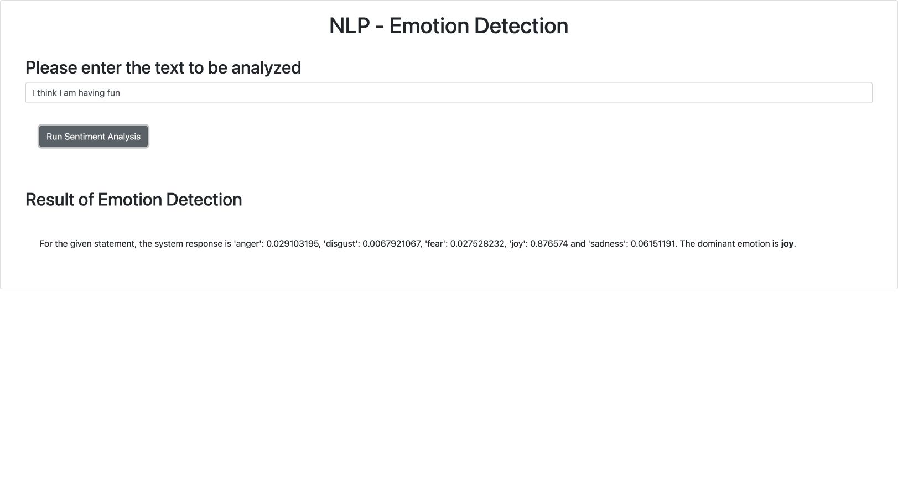
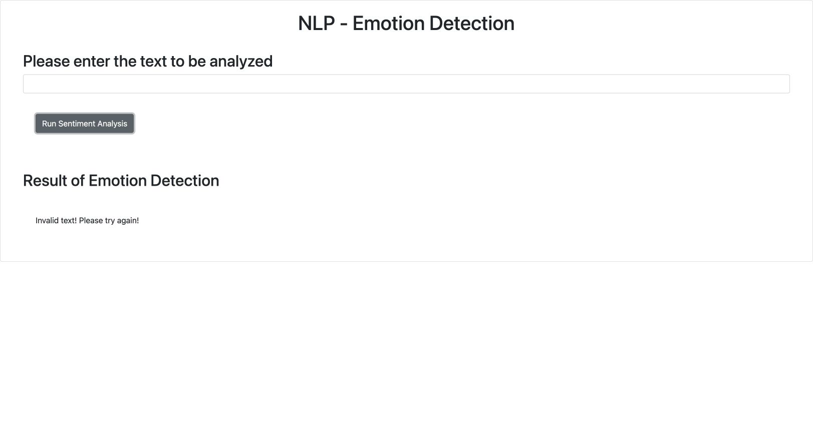

# Final project — Submission answers

Code snippets and real terminal outputs in rubric order. Live Watson evidence was collected inside Skills Network Theia on 6 November 2026. Copy the contents of each code block into the matching question. Upload the PNG files for the screenshot questions.

## Task 1 — GitHub README URL

https://github.com/kazuonguyen/oaqjp-final-project-emb-ai/blob/main/README.md

## Task 2 Activity 1 — emotion_detection.py (raw response)

```python
"""Task 2 snapshot: return the raw response text before formatting."""

import requests


def emotion_detector(text_to_analyze):
    """Call Watson EmotionPredict and return its response text."""
    url = (
        "https://sn-watson-emotion.labs.skills.network/v1/"
        "watson.runtime.nlp.v1/NlpService/EmotionPredict"
    )
    headers = {
        "grpc-metadata-mm-model-id": "emotion_aggregated-workflow_lang_en_stock"
    }
    response = requests.post(
        url,
        json={"raw_document": {"text": text_to_analyze}},
        headers=headers,
        timeout=30,
    )
    response.raise_for_status()
    return response.text
```

## Task 2 Activity 2 — Import and test output

```text
Captured: 2026-11-06T03:12:26.100519+00:00
$ /usr/bin/python3 -c from emotion_detection import emotion_detector; print(emotion_detector("I love this new technology."))
{"emotionPredictions":[{"emotion":{"anger":0.01364663, "disgust":0.0017160787, "fear":0.008986978, "joy":0.9719017, "sadness":0.055187024}, "target":"", "emotionMentions":[{"span":{"begin":0, "end":27, "text":"I love this new technology."}, "emotion":{"anger":0.01364663, "disgust":0.0017160787, "fear":0.008986978, "joy":0.9719017, "sadness":0.055187024}}]}], "producerId":{"name":"Ensemble Aggregated Emotion Workflow", "version":"0.0.1"}}

Exit status: 0
```

## Task 3 Activity 1 — Formatted output code

```python
"""Task 3 snapshot: format Watson emotion scores and select the maximum."""

import json

import requests

API_URL = (
    "https://sn-watson-emotion.labs.skills.network/v1/"
    "watson.runtime.nlp.v1/NlpService/EmotionPredict"
)
HEADERS = {
    "grpc-metadata-mm-model-id": "emotion_aggregated-workflow_lang_en_stock"
}
EMOTIONS = ("anger", "disgust", "fear", "joy", "sadness")


def emotion_detector(text_to_analyze):
    """Return the five emotion scores plus the dominant emotion."""
    response = requests.post(
        API_URL,
        headers=HEADERS,
        json={"raw_document": {"text": text_to_analyze}},
        timeout=30,
    )
    response.raise_for_status()
    response_dict = json.loads(response.text)
    scores = response_dict["emotionPredictions"][0]["emotion"]
    result = {emotion: scores[emotion] for emotion in EMOTIONS}
    result["dominant_emotion"] = max(result, key=result.get)
    return result
```

## Task 3 Activity 2 — Formatted output test

```text
Captured: 2026-11-06T03:12:26.448938+00:00
$ /usr/bin/python3 -c from emotion_detection import emotion_detector; result = emotion_detector("I am so happy I am doing this"); print(result); assert result["dominant_emotion"] == "joy"
{'anger': 0.0043079085, 'disgust': 0.00041127237, 'fear': 0.0037504788, 'joy': 0.9918804, 'sadness': 0.014091322, 'dominant_emotion': 'joy'}

Exit status: 0
```

## Task 4 Activity 1 — Package __init__.py URL

https://github.com/kazuonguyen/oaqjp-final-project-emb-ai/blob/main/EmotionDetection/__init__.py

## Task 4 Activity 2 — Package validation output

```text
Captured: 2026-11-06T03:12:26.794211+00:00
$ /usr/bin/python3 -c from EmotionDetection.emotion_detection import emotion_detector; result = emotion_detector("I hate working long hours"); print(result); assert result["dominant_emotion"] == "anger"
{'anger': 0.64949876, 'disgust': 0.03718168, 'fear': 0.05612277, 'joy': 0.00862553, 'sadness': 0.1955148, 'dominant_emotion': 'anger'}

Exit status: 0
```

## Task 5 Activity 1 — Required unit tests

```python
"""Required course tests; run inside Skills Network Theia with live Watson."""

import unittest

from EmotionDetection.emotion_detection import emotion_detector


class TestEmotionDetection(unittest.TestCase):
    """Check the five required statements against the real Watson service."""

    def test_joy(self):
        """A glad statement should express joy."""
        result = emotion_detector("I am glad this happened")
        self.assertEqual(result["dominant_emotion"], "joy")

    def test_anger(self):
        """A mad statement should express anger."""
        result = emotion_detector("I am really mad about this")
        self.assertEqual(result["dominant_emotion"], "anger")

    def test_disgust(self):
        """A disgusted statement should express disgust."""
        result = emotion_detector("I feel disgusted just hearing about this")
        self.assertEqual(result["dominant_emotion"], "disgust")

    def test_sadness(self):
        """A sad statement should express sadness."""
        result = emotion_detector("I am so sad about this")
        self.assertEqual(result["dominant_emotion"], "sadness")

    def test_fear(self):
        """An afraid statement should express fear."""
        result = emotion_detector("I am really afraid that this will happen")
        self.assertEqual(result["dominant_emotion"], "fear")


if __name__ == "__main__":
    unittest.main(verbosity=2)
```

## Task 5 Activity 2 — Five live Watson tests passed

```text
Captured: 2026-11-06T03:12:27.652819+00:00
$ /usr/bin/python3 -m unittest test_emotion_detection -v
test_anger (test_emotion_detection.TestEmotionDetection)
A mad statement should express anger. ... ok
test_disgust (test_emotion_detection.TestEmotionDetection)
A disgusted statement should express disgust. ... ok
test_fear (test_emotion_detection.TestEmotionDetection)
An afraid statement should express fear. ... ok
test_joy (test_emotion_detection.TestEmotionDetection)
A glad statement should express joy. ... ok
test_sadness (test_emotion_detection.TestEmotionDetection)
A sad statement should express sadness. ... ok

----------------------------------------------------------------------
Ran 5 tests in 0.631s

OK

Exit status: 0
```

## Task 6 Activity 1 — Flask server.py

```python
"""Serve the Emotion Detector web application with Flask.

Run static code analysis from the project directory: pylint server.py
"""

from flask import Flask, render_template, request
from requests.exceptions import RequestException

from EmotionDetection.emotion_detection import emotion_detector

app = Flask(__name__)


@app.route("/")
def index():
    """Render the supplied text entry interface."""
    return render_template("index.html")


@app.route("/emotionDetector")
def emotion_detector_route():
    """Analyze submitted text and format scores or an actionable error."""
    text_to_analyze = request.args.get("textToAnalyze", "")
    try:
        result = emotion_detector(text_to_analyze)
    except RequestException:
        return "Emotion service is unavailable. Please try again later."

    if result["dominant_emotion"] is None:
        return "Invalid text! Please try again!"

    return (
        "For the given statement, the system response is "
        f"'anger': {result['anger']}, 'disgust': {result['disgust']}, "
        f"'fear': {result['fear']}, 'joy': {result['joy']} and "
        f"'sadness': {result['sadness']}. "
        f"The dominant emotion is <b>{result['dominant_emotion']}</b>."
    )


if __name__ == "__main__":
    app.run(host="127.0.0.1", port=5000, debug=False)
```

## Task 6 Activity 2 — Deployment screenshot

Upload **6b_deployment_test.png** from the `evidence/` folder.



## Task 7 Activity 1 — Status 400 handling

```python
"""Detect five emotions using the Skills Network Watson NLP service."""

import json

import requests

API_URL = (
    "https://sn-watson-emotion.labs.skills.network/v1/"
    "watson.runtime.nlp.v1/NlpService/EmotionPredict"
)
HEADERS = {
    "grpc-metadata-mm-model-id": "emotion_aggregated-workflow_lang_en_stock"
}
EMOTIONS = ("anger", "disgust", "fear", "joy", "sadness")


def emotion_detector(text_to_analyze):
    """Return emotion scores and their maximum, or None values for invalid text."""
    empty_result = dict.fromkeys((*EMOTIONS, "dominant_emotion"))
    if not isinstance(text_to_analyze, str) or not text_to_analyze.strip():
        return empty_result

    response = requests.post(
        API_URL,
        headers=HEADERS,
        json={"raw_document": {"text": text_to_analyze}},
        timeout=30,
    )
    if response.status_code == 400:
        return empty_result
    response.raise_for_status()
    response_dict = json.loads(response.text)
    scores = response_dict["emotionPredictions"][0]["emotion"]
    result = {emotion: scores[emotion] for emotion in EMOTIONS}
    result["dominant_emotion"] = max(result, key=result.get)
    return result
```

## Task 7 Activity 2 — Blank input handling in server.py

```python
"""Serve the Emotion Detector web application with Flask.

Run static code analysis from the project directory: pylint server.py
"""

from flask import Flask, render_template, request
from requests.exceptions import RequestException

from EmotionDetection.emotion_detection import emotion_detector

app = Flask(__name__)


@app.route("/")
def index():
    """Render the supplied text entry interface."""
    return render_template("index.html")


@app.route("/emotionDetector")
def emotion_detector_route():
    """Analyze submitted text and format scores or an actionable error."""
    text_to_analyze = request.args.get("textToAnalyze", "")
    try:
        result = emotion_detector(text_to_analyze)
    except RequestException:
        return "Emotion service is unavailable. Please try again later."

    if result["dominant_emotion"] is None:
        return "Invalid text! Please try again!"

    return (
        "For the given statement, the system response is "
        f"'anger': {result['anger']}, 'disgust': {result['disgust']}, "
        f"'fear': {result['fear']}, 'joy': {result['joy']} and "
        f"'sadness': {result['sadness']}. "
        f"The dominant emotion is <b>{result['dominant_emotion']}</b>."
    )


if __name__ == "__main__":
    app.run(host="127.0.0.1", port=5000, debug=False)
```

## Task 7 Activity 3 — Error handling screenshot

Upload **7c_error_handling_interface.png** from the `evidence/` folder.



## Task 8 Activity 1 — Server code analyzed by Pylint

```python
"""Serve the Emotion Detector web application with Flask.

Run static code analysis from the project directory: pylint server.py
"""

from flask import Flask, render_template, request
from requests.exceptions import RequestException

from EmotionDetection.emotion_detection import emotion_detector

app = Flask(__name__)


@app.route("/")
def index():
    """Render the supplied text entry interface."""
    return render_template("index.html")


@app.route("/emotionDetector")
def emotion_detector_route():
    """Analyze submitted text and format scores or an actionable error."""
    text_to_analyze = request.args.get("textToAnalyze", "")
    try:
        result = emotion_detector(text_to_analyze)
    except RequestException:
        return "Emotion service is unavailable. Please try again later."

    if result["dominant_emotion"] is None:
        return "Invalid text! Please try again!"

    return (
        "For the given statement, the system response is "
        f"'anger': {result['anger']}, 'disgust': {result['disgust']}, "
        f"'fear': {result['fear']}, 'joy': {result['joy']} and "
        f"'sadness': {result['sadness']}. "
        f"The dominant emotion is <b>{result['dominant_emotion']}</b>."
    )


if __name__ == "__main__":
    app.run(host="127.0.0.1", port=5000, debug=False)
```

## Task 8 Activity 2 — Pylint 10.00/10 output

```text
Captured: 2026-11-06T03:12:25.758993+00:00
$ /usr/bin/python3 -m pylint server.py

------------------------------------
Your code has been rated at 10.00/10


Exit status: 0
```
